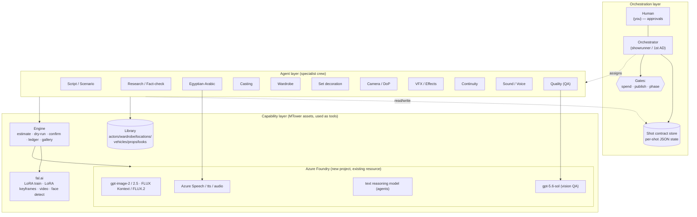
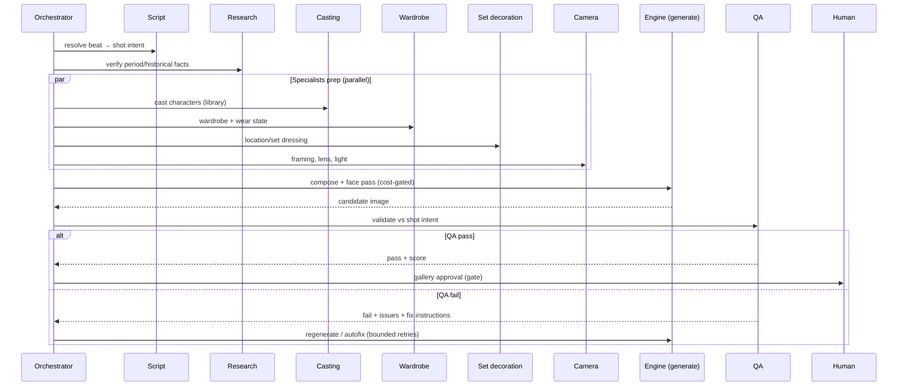

# 01 — Target Architecture

**Status:** draft, 2026-10-14. Grounded in the live MTower engine and the Azure feasibility probe. Decisions live in [adr/](adr/); landing-zone detail in [04-azure-landing-zone.md](04-azure-landing-zone.md).

## 1. The big picture

Three layers, cleanly separated:

1. **Orchestration layer** — the orchestrator (showrunner / 1st AD) owns the production plan, assigns work, enforces spend/approval gates, and moves each shot through its lifecycle.
2. **Agent layer** — a crew of specialist agents, each owning one craft. Agents never call each other directly; they read and write the **shot contract** and are scheduled by the orchestrator.
3. **Capability layer** — the existing MTower assets the agents use as *tools*: the **library** (actors, wardrobe, locations, vehicles, props, looks), the **engine** (generation, cost control, ledger, gallery), and the **model deployments** on Azure Foundry + fal.ai.

## 2. Core rule: agents coordinate through state, not through each other

Every agent's job is a **pure function of the shot contract**: read the current shot state, do your craft, write your result (and any issues) back. The orchestrator decides *who runs when*. This is what keeps a 12-agent system debuggable:

- No agent-to-agent spaghetti; the dependency graph lives in the orchestrator.
- Any step can be **re-run** in isolation (re-QA a frame, re-cast a role) without replaying the whole pipeline.
- The contract is the single audit trail: who touched this shot, what they decided, what it cost.

See [03-orchestration.md](03-orchestration.md) for the contract schema and the lifecycle state machine.

## 3. What is an "agent" here

An agent = **a model + a role prompt + a tool set + a definition of done**, running in an orchestrator-driven loop. Three implementation options, chosen per role:

| Kind | When | Example roles |
|---|---|---|
| **Hosted Foundry agent** | Needs autonomy, tool-calling, managed threads, runs unattended | Research, QA, orchestrator (later waves) |
| **Engine-local agent** (LLM call wrapped by `studio/engine`) | Needs tight cost control, local file/library access, human-in-loop | Wave 1 everything (fastest to prove) |
| **Deterministic tool** (no LLM) | The step is mechanical | shot-list validation, cost estimate, ledger, gallery |

**Wave 1 recommendation:** build agents as **engine-local** first (reuse MTower's cost control, library resolver, and ledger directly), then **promote** the stable ones to hosted Foundry agents when they need to run unattended or in parallel at scale. This mirrors the "build in VSCode, operationalize in Foundry" split.

## 4. How a shot flows (target)

## 5. Relationship to MTower (today)

Nothing here throws MTower away. The mapping:

| MTower today | Becomes in Studio |
|---|---|
| `qa.py` + `autofix.py` (vision QA loop) | **QA agent** (already the prototype for the whole idea) |
| `casting.py` + `library.py` | **Casting agent** + the shared library tool |
| `prompts.py` (prompt composer) | split across **Script / Camera / Set / Wardrobe** agents that each contribute to the prompt |
| `production.py` (batch runner) | **Orchestrator** scheduling + the engine as a generation tool |
| `costs.py` + `ledger.jsonl` | unchanged — the orchestrator's **spend gate** |
| the human directing in chat | **Orchestrator** + human approvals at gates |

The migration ([05-migration-plan.md](05-migration-plan.md)) is therefore a **wrap-and-promote**, not a rewrite.

## 6. Cross-cutting concerns

- **Cost control** stays exactly as MTower defined it: estimate → dry-run → `--confirm-cost` → ledger, with per-batch and monthly caps. The orchestrator refuses to dispatch a generation step that would breach a cap; spend is always a human gate.
- **Library-first** is enforced by the orchestrator: casting/wardrobe/set agents must resolve existing library IDs before proposing new assets.
- **Approvals**: spend, publish/share, and phase transitions are always human gates. Routine creative decisions follow the agent's recommendation and are logged to the contract.
- **Observability**: every agent action appends to the shot contract's history; Foundry run traces + the engine ledger give the full picture.
- **Security/guardrails**: inherited from the landing zone (East US 2, Entra-only, IP allow-list / NSP, keys disabled). See [04-azure-landing-zone.md](04-azure-landing-zone.md).
