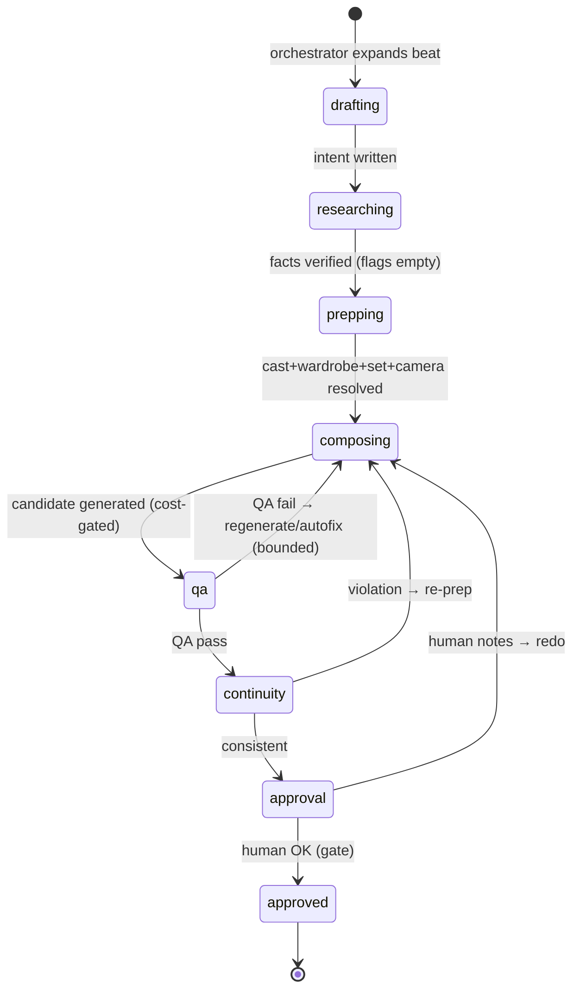

# 03 — Orchestration & the Shot Contract

**Status:** draft, 2026-10-14. This is the keystone: the orchestrator model and the shared **shot contract** that every agent reads and writes. Get this right and the fleet composes cleanly; get it wrong and 12 agents become 12 ways to lose fidelity.

## 1. The orchestrator

The orchestrator is the showrunner / 1st AD. It does **not** do any craft itself — it owns the board:

- **Plans:** expands a locked beat into the set of shots and their required agent steps.
- **Schedules:** decides which agent runs next for each shot, running independent agents in parallel and dependent ones in order.
- **Enforces gates:** spend, publish/share, and phase transitions are human approvals; it will not dispatch a paid generation step that breaches a cost cap.
- **Routes outcomes:** on a QA fail it sends the shot to regenerate/autofix (bounded retries) before escalating to a human; on a continuity violation it routes to the owning craft.
- **Records:** every assignment and result is appended to the shot's history for audit.

### Where the orchestrator runs

| Option | Pros | Cons | Use when |
|---|---|---|---|
| **Engine-local** (Python loop in `studio/engine`) | Reuses MTower cost control, library, ledger; tight human-in-loop; fastest to build | You run it; not unattended | **Wave 1** (recommended start) |
| **Hosted Foundry agent** | Autonomous, parallel, managed threads/traces, scheduled runs | More plumbing; needs the fleet promoted to hosted agents | Wave 2+ once the contract is stable |

**Recommendation:** start engine-local to prove the contract against real Episode-1 shots, then promote to a hosted Foundry orchestrator when you want overnight batch runs.

## 2. The shot contract

One JSON document **per shot**, the single source of truth for that shot's state. Agents are pure functions over it: read your inputs, write your fields, append to history. No agent writes another agent's fields (continuity and QA are read-only reviewers that write only their own review fields).

### 2.1 Schema (v0 draft)

```jsonc
{
  "shot_id": "2.5-03",                 // production-unique
  "production": "thunderbolt",
  "episode": "ep01_romani",
  "beat_ref": "2.5",                   // screenplay beat
  "status": "qa",                      // lifecycle state (see §3)
  "wave_ready": 1,                     // highest wave whose agents have run

  "intent": {                          // Script agent
    "subject": "Captain Hamdi at the radio, moonlit",
    "action": "whispers coordinates into a field radio",
    "setting": "canal embankment, night",
    "time_of_day": "night",
    "mood": "steely calm",
    "refs": { "location": "LOC-0003", "props": ["PRP-0005"] }
  },

  "research": [                        // Research agent
    { "claim": "R-123 field radio in service 1967", "verdict": "verified",
      "source": "https://...", "note": "AN/GRC-9 equivalent" }
  ],
  "flags": [],                         // open anachronism/risk flags (must be empty to generate)

  "cast": [                            // Casting agent
    { "character_id": "C-01", "actor_id": "ACT-0001", "face_model": "act0001-v2" }
  ],
  "wardrobe": [                        // Wardrobe agent
    { "character_id": "C-01", "wardrobe_id": "WRD-0004", "wear_state": "field-dusty" }
  ],
  "set": {                             // Set-decoration agent
    "location_id": "LOC-0003",
    "dressing": ["sandbags", "comms crate"],
    "vehicles": [], "props": ["PRP-0005"]
  },
  "camera": {                          // Camera/DoP agent
    "shot_size": "MCU", "lens": "50mm", "movement": "static",
    "light": "moonlight key, low fill", "look_key": "night-canal", "format": "2.39:1"
  },
  "vfx": [],                           // VFX agent
  "continuity": {                      // Continuity agent (read-only reviewer)
    "prior_state_ref": "2.5-02", "deltas": [], "violations": []
  },

  "dialogue": [                        // Script + Egyptian-Arabic agents
    { "character_id": "C-01", "text_vo": "...", "egyptian": "...", "diacritized": true,
      "acting_note": "whispering into a radio, steely calm" }
  ],
  "vo": { "text": "...", "egyptian": "...", "diacritized": true },
  "voice_notes": "ar-EG-Shakir, close-mic, restrained",
  "audio": { "narration_take": null, "dialogue_takes": [], "sfx": [], "music_cue": null },

  "generation": {                      // Engine (tool, not an agent)
    "candidates": [
      { "path": "media/.../2.5-03/base_01.png", "provider": "azure/gpt-image-2",
        "cost_usd": 0.18, "created": "2026-10-14T09:00:00Z" }
    ],
    "selected": "base_01.png"
  },
  "qa": {                              // QA agent (read-only reviewer)
    "score": 8.5, "verdict": "pass", "gate": 8.0,
    "issues": [], "fix_instructions": [], "rounds": 1
  },

  "approval": {                        // Human gate
    "state": "pending", "by": null, "at": null, "notes": null
  },

  "cost_usd_total": 0.223,
  "history": [                         // append-only audit
    { "ts": "...", "agent": "script", "action": "wrote intent" },
    { "ts": "...", "agent": "qa", "action": "pass 8.5", "cost_usd": 0.06 }
  ]
}
```

### 2.2 Ownership map (who writes what)

| Field | Owner (writes) | Readers |
|---|---|---|
| `intent`, `dialogue[].text_vo`, `vo.text` | Script | all |
| `research[]`, `flags[]` | Research | Script, Set, VFX, orchestrator |
| `cast[]` | Casting | Wardrobe, Camera, engine |
| `wardrobe[]` | Wardrobe | Camera, QA, Continuity |
| `set` | Set decoration | Camera, VFX, QA |
| `camera` | Camera/DoP | engine, QA |
| `vfx[]` | VFX | QA, Sound |
| `continuity` | Continuity (reviewer) | orchestrator |
| `dialogue[].egyptian`, `vo.egyptian`, `voice_notes` | Egyptian-Arabic | Sound |
| `audio` | Sound | engine/animatic |
| `generation` | **Engine** (tool) | QA, Continuity, human |
| `qa` | QA (reviewer) | orchestrator, human |
| `approval` | **Human** | orchestrator |
| `history`, `cost_usd_total` | append-only, all steps | audit |

**Rule:** a reviewer (QA, Continuity) never edits a craft field; it writes its review and the orchestrator routes the fix back to the owning craft. This keeps the error-correction loop explicit and auditable.

## 3. Shot lifecycle (state machine)



- **Gate to `composing`:** `flags` empty (no open anachronism) and all Wave-2 craft fields present. The orchestrator will not spend on a shot with open research flags.
- **`qa` loop:** bounded to N autofix rounds (MTower uses up to 2) before escalating to a human.
- **Gate to `approved`:** human approval in the gallery — never automated.

## 4. Scheduling & parallelism

For one shot, the orchestrator runs:

1. **Serial:** Script → Research (research needs the intent; generation needs clean flags).
2. **Parallel:** Casting ∥ Wardrobe ∥ Set ∥ Camera (independent prep; wardrobe depends on cast, so Casting→Wardrobe is a mini-chain).
3. **Serial:** Engine compose → QA → Continuity → human approval.

Across shots, whole shots run in parallel up to the provider quota (gpt-image is quota-limited to ~2/min in MTower — the orchestrator respects this).

## 5. Error propagation (the thing multi-agent gets wrong)

Multi-agent systems amplify upstream mistakes. Defenses baked into the contract:

- **Flags block spend:** Research flags must be resolved before any paid generation — a wrong fact can't reach an expensive render.
- **Reviewers are separate paths:** QA and Continuity are independent of the generator, so they catch what the generator rationalizes.
- **Bounded retries + human escalation:** no infinite autofix loops; after N rounds a human decides.
- **Every decision is logged:** `history` + the engine ledger make any bad frame traceable to the agent and cost that produced it.

## 6. Open design questions

1. **Storage of the contract:** flat JSON per shot in the production repo (git, like MTower's shot lists) vs a small store (SQLite / Foundry thread state). Recommendation: start as JSON files next to the shot lists (diff-able, git-tracked), promote to a store only if parallelism demands it.
2. **Contract versioning:** add a `schema_version`; agents assert compatibility.
3. **Where the library lives:** shared read-only tool for all agents (today's `library/` catalogs) — unchanged.
4. **Orchestrator autonomy level for Wave 1:** how much runs before a human checkpoint (proposed: stop before every paid batch and before phase transitions).
