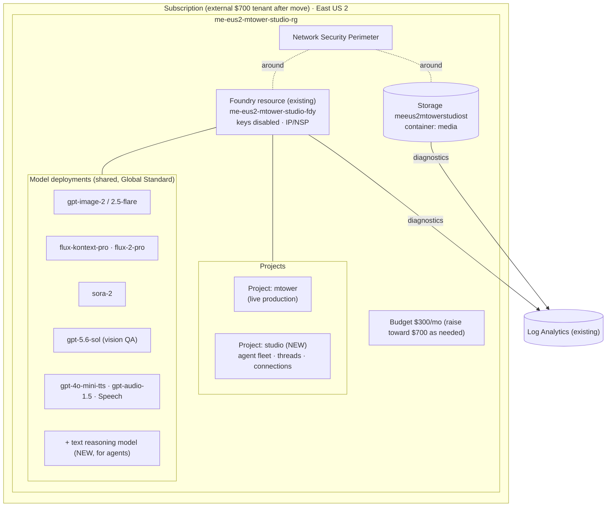

# 04 — Azure Landing Zone

**Status:** draft, 2026-10-14. Grounded in the live feasibility probe (2026-10-14) and MTower's `studio/infra` design + decision log. This describes where and how the agent fleet runs in Azure.

## 1. Decisions at a glance

| Topic | Decision | Why |
|---|---|---|
| **Subscription home** | External **personal $700/mo tenant** (confirms MTower D-02). Build-and-prove on the current `ME-MngEnvMCAP225775` sub until the tenant move completes. | Personal creative project; $700 pay-per-use is ample; the external tenant has **no MCAPSGov guardrails** and **self-service SPN creation**. |
| **Region** | **East US 2** | Only US region hosting *all* required models (gpt-image, sora-2, FLUX Kontext/FLUX.2, Speech). Provider-level fact — identical across subscriptions. |
| **Foundry topology** | **New dedicated project** inside the **existing Foundry resource**; reuse model deployments. | Clean isolation of agents/threads/RBAC from live production, with **no model redeploy or quota duplication**. |
| **Resource footprint** | Same *types* as MTower — no new resource kinds for the agent fleet. | Agents are prompts+tools+threads on the existing Foundry project. |
| **Cost control** | Engine caps (estimate→dry-run→confirm→ledger) + Azure budget with a **70% alert** + pay-per-use only. | Unchanged from MTower; the orchestrator enforces the spend gate. |

## 2. What the feasibility probe found (2026-10-14)

Probed live from the studio PC with the signed-in session:

**Subscriptions visible (Microsoft tenant `f2c3093b`):**
- `MCAPS-Hybrid-REQ-37883` (`ce60eb14`) — likely the "$3k MCAPS"; I hold **no direct role** at sub scope (inherited only).
- `ME-MngEnvMCAP225775` (`ac25e0cf`) — **current MTower home**; I hold **Owner + User Access Administrator (root)** → can self-grant data roles here. Already a live AI playground (an AI hub, a math-tutor resource, the MTower Foundry).
- External personal tenant (`973659a7` / `cbade9a5`) — **MFA-blocked during the probe; not yet verified live.**

**Providers** on the reachable subs: `Microsoft.CognitiveServices`, `Microsoft.MachineLearningServices`, `Microsoft.Storage` all **Registered**.

**Guardrails** (the key differentiator): both Microsoft-tenant subs carry **MCAPSGov Deny / Audit / Deploy** policy assignments. This is the family that forced MTower's **NSP workaround** (policy *SFI-NS2.2.1 — Secure PaaS storage*) and that disables plain public storage. The **external personal tenant carries none of these.**

**SPN creation:** an **Entra (tenant) permission, not a subscription one.** In the Microsoft tenant you generally cannot self-create app registrations (MTower's runbook notes "a new SPN will be provided"). In your **own external tenant you are admin** and create SPNs freely — removing a concrete future blocker.

## 3. Target resource topology

Reuses the MTower `studio/infra` Bicep shape; the only addition is a **second Foundry project**.

### New vs reused

| Resource | State | Note |
|---|---|---|
| Foundry resource | **reuse** | `me-eus2-mtower-studio-fdy` |
| Model deployments | **reuse** | all existing; **add one text reasoning model** for the non-vision agents |
| **Foundry project `studio`** | **NEW** | hosts the agent fleet, its threads, tool connections, and RBAC |
| Storage, NSP, budget, diagnostics | **reuse** | shared; raise budget toward $700 as the fleet grows |

## 4. Identity, security, guardrails (inherited)

- **Keys disabled** on Foundry and Storage; **Entra-only** access with the data roles (Cognitive Services User, Azure AI User, Storage Blob Data Contributor).
- **Network:** IP allow-list + NSP (Enforced) around Foundry and storage; only the studio PC's IP gets in. In the **external tenant the NSP requirement may relax** (no SFI-NS2.2.1) — revisit whether the allow-list alone suffices there.
- **SPN:** today one SPN with subscription Contributor (D-04). In the external tenant you can adopt the safer **deployer + engine-only** split at the move with no template changes.
- **Agent connections:** the new `studio` project's tool connections (to Storage, to web search for the Research agent) use the project's managed identity + the same data roles — no new secrets.

## 5. Cost outlook

- **Idle:** ~$0–3/mo (storage + a little logging). Deployments cost nothing idle.
- **Agent text traffic:** orchestration/research/wardrobe/script are **cheap text tokens** — cents per shot, not dollars.
- **Expensive calls** remain image/video/QA generation, already modeled in MTower (images $0.03–0.25, FLUX edit $0.04, QA $0.05–0.09, Sora $0.10/s).
- **Conclusion:** the full crew comfortably fits the **$700** budget; the **$3k MCAPS sub is not needed for cost reasons** and is the wrong *governance* home for a personal project.

## 6. Action items before Phase 2 (standing up Wave 1 in Azure)

1. **Verify the external tenant live** (re-auth past MFA): confirm East US 2 model availability + quota, and that you can create the `studio` project + an SPN there.
2. **Add a text reasoning model** deployment for the agents (cheap SKU) to the existing resource.
3. **Create the `studio` Foundry project** (Bicep addition to `studio/infra`, dry-run first).
4. **Decide NSP necessity** in the external tenant (may relax without MCAPSGov).
5. Keep everything **as code** so the tenant move is one re-deploy (MTower runbook §4).
