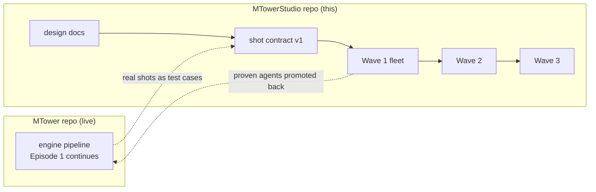
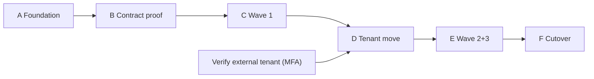

# 05 — Migration Plan: MTower → MTower Studio

**Status:** draft, 2026-10-14. How the live single-pipeline studio becomes the multi-agent studio **without stopping production** and **without a rewrite**. The strategy is **wrap-and-promote**, sequenced with the planned Azure tenant move.

## 1. Principles

- **Never break the running production.** Episode 1 is mid-flight (306 shots, approvals in progress). It keeps running on the MTower engine until a wave is proven.
- **Wrap, don't rewrite.** MTower's engine, library, cost control, and provider integrations are assets. Agents wrap them as tools.
- **One contract, proven early.** The shot contract ([03](03-orchestration.md)) is adopted first on a *copy* of real shots, in parallel with the current pipeline, before anything cuts over.
- **Everything as code.** So the tenant move is one re-deploy + re-grant (MTower runbook §4).

## 2. Two tracks running in parallel

Agents are proven in the new repo against **real Episode-1 shots**, then adopted by the production as each wave stabilizes.

## 3. Phased sequence

### Phase A — Foundation (this repo, now)
Design docs complete; shot contract v1 drafted. **No Azure, no code.**
- Exit: catalog + contract reviewed and approved by you.

### Phase B — Contract proof (local, no new Azure)
Model 3–5 real Episode-1 shots as shot-contract JSON by hand; walk them through the lifecycle on paper/engine. Confirm the ownership map and gates survive real data.
- Exit: contract schema v1 locked (`schema_version: 1`).

### Phase C — Wave 1 fleet (new Foundry `studio` project)
Stand up Orchestrator + Script + Research + QA as **engine-local** agents reusing MTower's cost control, library, and ledger. Run the generate → QA → regenerate loop on real shots in parallel with production.
- **Azure:** create the `studio` project + add a text reasoning model (see [04 §6](04-azure-landing-zone.md)).
- Exit: Wave 1 reproduces or beats the current QA loop on a sample scene.

### Phase D — Tenant move (gated by the external-tenant verification)
Move the subscription to the external $700 tenant per MTower runbook §4: re-create SPN, re-deploy Bicep (now including the `studio` project), re-grant data roles, re-point diagnostics, `Test-Studio`.
- Exit: both `mtower` and `studio` projects healthy in the external tenant; SPN self-created there.

### Phase E — Wave 2 + 3
Add wardrobe, set, camera, casting (Wave 2), then VFX, continuity, sound, Egyptian-Arabic (Wave 3). Promote stable agents to **hosted Foundry agents** for unattended batch runs.
- Exit: a whole beat produced end-to-end by the fleet.

### Phase F — Cutover
Episode 2 (or a fresh scene of Episode 1) is produced **fleet-first**, with the engine as a pure generation tool. MTower engine remains the fallback.
- Exit: the fleet is the default production path.

## 4. What moves, what stays

| Asset | Disposition |
|---|---|
| Library catalogs (actors/wardrobe/locations/vehicles/props/looks) | **Stay in MTower**, shared read-only tool for the fleet. Single source of truth — do not fork. |
| Engine (cost control, ledger, gallery, generation) | **Stays**, wrapped as the fleet's generation + spend tool. |
| Provider integrations (Azure Foundry, fal.ai, Speech) | **Stay**, reused. |
| Shot lists / screenplay | **Stay in MTower**; the Script agent reads them, the contract references them. |
| QA / autofix logic | **Promoted** to the QA agent (first mover). |
| Azure infra (Bicep) | **Extended** with the `studio` project; migrates via the tenant move. |

## 5. Risks & mitigations

| Risk | Mitigation |
|---|---|
| Multi-agent error amplification | Research flags block spend; QA/Continuity are independent reviewers; bounded retries + human escalation ([03 §5](03-orchestration.md)). |
| Destabilizing live Episode 1 | Fleet proven in parallel on *copies* of shots; cutover only per wave. |
| Tenant move deletes role assignments | Everything as code; re-grant scripted (runbook §4). |
| External tenant model/quota unknown | **Verify before Phase C** (re-auth past MFA). |
| Library drift between repos | Library stays single-source in MTower; fleet reads it, never forks it. |
| Cost creep from many agents | Agent text traffic is cheap; spend gate is at the orchestrator; budget alerts unchanged. |

## 6. Dependencies between phases

The only hard external dependency is **verifying the external tenant** before the tenant move; everything else is internal and sequenced.
