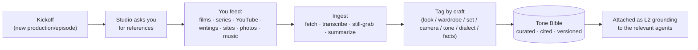

# 07 — Reference Intake & the Tone Bible

**Status:** Accepted, 2026-10-14. A pre-production pipeline where the studio **asks you for references** (films, series, YouTube, writings, footage, photos, music) and turns them into a curated **Tone Bible** that grounds every agent's taste and the production's factual world. This is the real-world *lookbook / mood board + research dossier*, made into a repeatable studio step.

## Why

Agents reason from two things: craft (L1 persona) and grounding (L2). Craft they ship with; **grounding is yours to supply.** Before anyone writes a shot or renders a frame, the crew needs to *feel* what you're going for — the tone of comparable films, the look of the period, the rhythm of similar series. The Tone Bible is how the whole fleet aligns on "what are we actually trying to make" from the same source material.

## The intake pipeline

1. **Kickoff trigger.** When a new production or episode starts, the orchestrator runs the intake step before scenario work — led by the **Director** (creative tone) and **Research** (factual sources).
2. **The studio asks you** a structured set of reference questions (below) via the orchestrator. You reply with links and files; you can add more any time.
3. **Ingest.** The studio fetches and normalizes each reference: web pages → text, YouTube → transcript + representative stills, images → tagged stills, writings → summarized notes. Long sources are distilled into short **tone notes** ("handheld, desaturated, patient wides; dread over spectacle").
4. **Tag by craft.** Each reference is labeled with the agents it serves (a street photo → Set + Camera; a dialect clip → Egyptian-Arabic; a battle doc → Research + VFX).
5. **Tone Bible.** The curated, cited, versioned result — the single grounding corpus, retrievable by agents as an L2 knowledge tool.

## What the studio asks you for (intake checklist)

| Bucket | Examples | Primarily grounds |
|---|---|---|
| **Tonal / comparable titles** | "like *Kippur* for dread, *Black Hawk Down* for chaos, early *Band of Brothers* for intimacy" | Director, Script |
| **Visual look** | film stills, color/grain refs, day-for-night examples | Camera/DoP, Director, Set |
| **Period & place** | 1967–73 Sinai photos, uniforms, street scenes, vehicles | Research, Set, Wardrobe, VFX |
| **Footage / docs** | YouTube docs, archival clips, interviews | Research, Director, Sound |
| **Writings** | memoirs, articles, after-action accounts | Research, Script |
| **Language / dialect** | clips of Egyptian speech, period slang, songs | Egyptian-Arabic, Sound |
| **Music / sound** | scores, ambience, songs of the era | Sound |

## Ownership & where it plugs in

- **Owned by:** Director (tone/creative) + Research (facts), triggered by the Orchestrator at kickoff.
- **Consumed by:** every agent, via L2 grounding ([06-agent-competence-model.md](06-agent-competence-model.md)). The Director's `tone_ref` fields and the Script's scene mood point at Tone Bible entries.
- **Lives in:** the production repo as a curated, git-tracked corpus (notes + citations + tagged stills), attached to the Foundry project as a retrievable knowledge source.
- **Versioned:** the Tone Bible has a version; when you add references, agents pick up the new grounding on their next run.

## Guardrails (important)

- **References are for taste and facts, not reproduction.** We ingest to understand tone, period, and truth — never to copy a copyrighted film's shots, dialogue, or music into our output. The Tone Bible informs original work; it is not a source to clone.
- **Cite everything.** Each tone note keeps its source link, so Research can stand behind factual claims and we can tell inspiration from invention.
- **You stay in control.** You choose what goes in; you can prune or correct any entry. The studio asks; it never scrapes on its own beyond the links you give (plus the Research agent's sourced fact-checking).

## Status for Thunderbolt

Episode 1's script is already locked, so the Tone Bible is **retro-fitted**: we can seed it from the existing series bible, visual guide, and your reference pull now, and it becomes the standard **first step** for Episode 2 onward.
