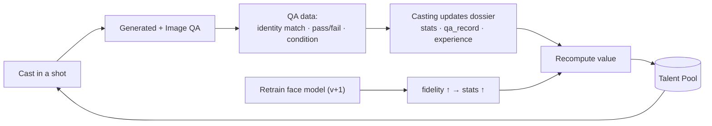

# 08 — Talent Pool & Actor Evolution

**Status:** Accepted (design), 2026-10-14. A standing **talent agency** of virtual actors the studio casts from, reusable across every production, where actors **evolve** — accruing stats, ratings, and value from the studio's own QA data, like a career. Owned by the **Casting agent** ([02-agent-catalog.md](02-agent-catalog.md) §4).

## Concept

Today's actors are seeded per episode. The Talent Pool turns them into a **reusable roster** — diverse in age, gender, ethnicity, and type — that any production can cast from, and that **gets better over time** as face models are refined and performance data accumulates. Think of a Hollywood agency crossed with a FIFA-style player-progression system, but every rating is **grounded in real pipeline signals**, not invented.

## Cost-aware build strategy (important)

Each actor = an anchor portrait + a trained face model = training cost + storage + curation. So:

- **Design the full system now** (schema, ratings, evolution) — this is cheap, it's just structure.
- **Seed a modest, diverse core** of the archetypes productions most need.
- **Grow on demand** — when a production needs a role no one fills, Casting proposes a candidate and (on user approval) a new actor is created and trained.
- **Never pre-train unused talent.** Evolution runs automatically on whoever is actually cast.

## The actor dossier (schema v0 draft)

```jsonc
{
  "actor_id": "ACT-0007",
  "name": "Karim (stage name)",
  "status": "free",                 // free | cast | locked_to_role | retired
  "demographics": { "apparent_age": 34, "gender": "male",
                    "ethnicity": "Egyptian", "build": "lean" },
  "physical": { "height_cue": "tall", "hair": "black short",
                "facial_hair": "stubble", "distinguishing": "scar left brow" },
  "face_model": { "version": 2, "trigger_word": "k4rim",
                  "provider": "fal/flux-lora", "fidelity": 0.91 },
  "specialties": ["restrained emotion", "night close-ups", "military bearing"],
  "range_tags": ["drama", "action"],

  "stats": {                        // 0–100, derived from QA data
    "overall": 88,
    "consistency": 92,              // avg identity-match from Image QA
    "range": 80,                    // spread of emotions/looks passed
    "by_condition": { "night": 90, "closeup": 93, "action": 82, "crowd": 75 }
  },
  "experience": {
    "productions": ["thunderbolt"], "roles": ["C-05"],
    "shots_appeared": 41, "retrains": 1
  },
  "qa_record": {
    "avg_identity_match": 0.92, "qa_pass_rate": 0.86,
    "last_evaluated": "2026-10-13"
  },
  "value": 74,                      // derived "transfer value" (see formula)
  "history": [                      // append-only career log
    { "ts": "...", "event": "trained v1" },
    { "ts": "...", "event": "retrained v2 — scarf bias removed" },
    { "ts": "...", "event": "cast as C-05 in thunderbolt" }
  ]
}
```

## Evolution loop (how actors level up)



- **Signals are objective:** `consistency` and `qa_record` come straight from Image QA's identity-match scores and pass/fail; `by_condition` scores are bucketed by shot type.
- **Retraining = a training camp:** a new face-model version that reduces a known bias (e.g. MTower's "scarf bias removed, v2") raises fidelity and the derived stats.
- **Experience accrues:** shots and roles increment; veterans with high pass-rates rise.

## Value formula (starting point, tunable)

```
value = round( 0.45*consistency + 0.25*range
             + 0.15*(100*qa_pass_rate) + 0.10*(100*face_model.fidelity)
             + 0.05*experience_bonus )
```

`experience_bonus` scales with shots/roles (capped). Value is the at-a-glance "how good/bankable is this actor" — it drives Casting's recommendations and lets you build a roster deliberately.

## How Casting uses it

- **Recommend by fit + rating:** "this night close-up → ACT-0007 (consistency 92, night 90)."
- **Build the ensemble:** enforce the stricter distinctness rule *and* prefer higher-value actors for framed roles.
- **Spot weak talent:** low pass-rate actors are flagged for retraining or retirement.
- **Grow deliberately:** gaps become candidate proposals for your approval.

## Ownership & phasing

- **Owner:** the Casting agent (per-shot casting + Talent Pool upkeep + evolution). Split out a dedicated **Talent Manager** agent later only if upkeep grows heavy.
- **Lives in:** the shared `studio/library` (a new `talent/` catalog), reused across productions — not inside any one production.
- **Phase:** schema + seed core in Wave 2 (with Casting); evolution wired to Image QA data as soon as both are live.

## Guardrails

- Ratings are **derived from QA data**, never hand-waved — keeps the system honest.
- New actors and retrains **cost money** → always a user-approved, cost-gated action.
- Real-person stand-ins are `locked_to_role` and exempt from the "free agent" pool.
